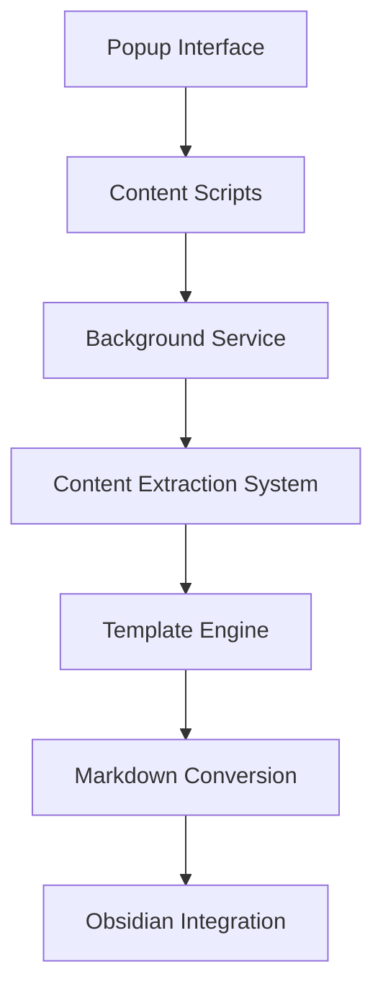

# obsidianmd/obsidian-clipper

> Browser extension that captures and highlights the web into Markdown files for Obsidian.

## The problem
Web pages copied by hand lose their structure and end up outside your notes base.

## What it actually does
The extension extracts a page's content, converts it to Markdown via templates, variables and filters, and saves it into Obsidian. It lets you highlight. It exists for Chrome and derivatives, Firefox, Safari (macOS, iOS, iPadOS) and Edge. Templates are compressed to save storage.

## How it is wired


## Trying it
```bash
npm run build
npm test
```

## Cost and gotchas
Free, no key. To test a local version, load the `dist` folder in developer mode; Firefox requires extra settings.

## What it is not
Not a mass scraping tool nor a PDF reader: it captures the page open in your browser. It assumes you use Obsidian.

## Alternatives
No alternative named in the README.

## For you
Worth adopting if you keep your watch in Obsidian: clean capture into local Markdown, with no account or service.
