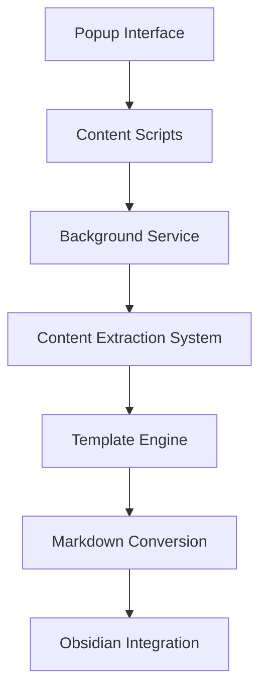

# obsidianmd/obsidian-clipper

> Extension de navigateur qui capture et surligne le web en fichiers Markdown pour Obsidian.

## Le problème
Les pages web copiées à la main perdent leur structure et finissent hors de ta base de notes.

## Ce que ça fait vraiment
L'extension extrait le contenu d'une page, le convertit en Markdown via des modèles, variables et filtres, et l'enregistre dans Obsidian. Elle permet de surligner. Elle existe pour Chrome et dérivés, Firefox, Safari (macOS, iOS, iPadOS) et Edge. Les modèles sont compressés pour économiser le stockage.

## Comment c'est branché


## Essayer
```bash
npm run build
npm test
```

## Coût et pièges
Gratuit, aucune clé. Pour tester une version locale, charger le dossier `dist` en mode développeur ; Firefox demande des réglages supplémentaires.

## Ce que ce n'est pas
Ce n'est pas un outil de scraping en masse ni un lecteur de PDF : il capture la page ouverte dans ton navigateur. Il suppose d'utiliser Obsidian.

## Alternatives
Aucune alternative nommée dans le README.

## Pour toi
À adopter si tu tiens ta veille dans Obsidian : capture propre en Markdown local, sans compte ni service.

