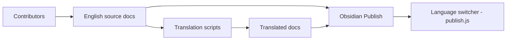

# obsidianmd/obsidian-help

> Sources of Obsidian's documentation and its translations, published as sites per language.

## The problem
Maintaining product documentation in dozens of languages, consistent with the English, is heavy.

## What it actually does
Each language is a standalone vault linked to an Obsidian Publish site; English (`en`) is the source. Scripts copy and apply the English changes to the translations (deterministic, by blocks, or new translation of a page), with a first machine translation to be refined. Pages share a `permalink` across languages, and every commit on `main` is published.

## How it is wired

## Trying it
No command in the README: open a language's subfolder (e.g. `/en/`) as a vault in Obsidian; do not open the root.

## Cost and gotchas
Free. Do not open software bugs here (they are closed). No license. The state of the translation automation is not described beyond the README.

## What it is not
Not Obsidian's code nor a usage guide: these are the doc sources. The application's texts come from `obsidian-translations`.

## Alternatives
obsidian-translations (source of the application's texts).

## For you
Ignore: except to contribute to the docs; however, the "English first, scripts, machine translation" flow can inspire your own multilingual docs.
