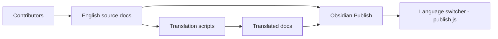

# obsidianmd/obsidian-help

> Sources de la documentation d'Obsidian et de ses traductions, publiées en sites par langue.

## Le problème
Maintenir une documentation produit dans des dizaines de langues, cohérente avec l'anglais, est lourd.

## Ce que ça fait vraiment
Chaque langue est un vault autonome relié à un site Obsidian Publish ; l'anglais (`en`) est la source. Des scripts copient et appliquent les changements anglais aux traductions (déterministes, par blocs, ou nouvelle traduction de page), avec une première traduction automatique à affiner. Les pages partagent un `permalink` entre langues, et tout commit sur `main` est publié.

## Comment c'est branché

## Essayer
Aucune commande dans le README : ouvrir le sous-dossier d'une langue (ex. `/en/`) comme vault dans Obsidian ; ne pas ouvrir la racine.

## Coût et pièges
Gratuit. Ne pas ouvrir de bogues du logiciel ici (ils sont fermés). Licence absente. L'état de l'automatisation des traductions n'est pas décrit au-delà du README.

## Ce que ce n'est pas
Pas le code d'Obsidian ni un guide d'usage : ce sont les sources de la doc. Les textes de l'application viennent de `obsidian-translations`.

## Alternatives
obsidian-translations (source des textes de l'application).

## Pour toi
Ignorer : sauf pour contribuer à la doc ; en revanche, le flux « anglais d'abord, scripts, traduction automatique » peut inspirer ta propre doc multilingue.

