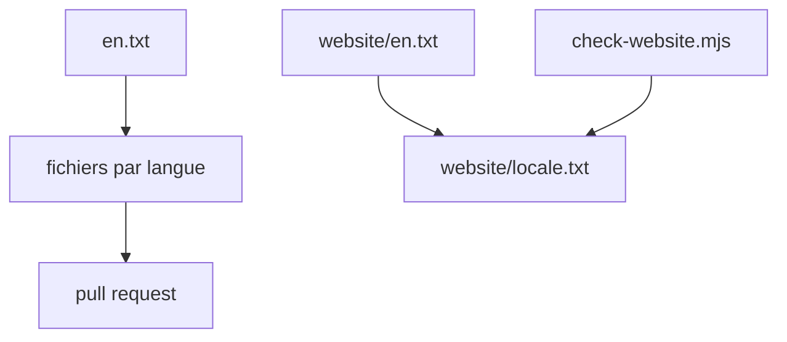

# obsidianmd/obsidian-translations

> Translation files for the Obsidian app and website, for volunteer translators.

## The problem
Obsidian needs to exist in many languages without the team translating everything itself.

## What it actually does
One `.txt` file per language, in key, `original=`, `translation=` blocks. Contributions go through pull requests. A `website/` folder translates the marketing pages, with a `check-website.mjs` script that spots missing keys. The README keeps the table of languages and their status (app, site, help).

## How it is wired


## Trying it
```bash
node scripts/check-website.mjs
```
Test in the Obsidian console: `selectLanguageFileLocation()`.

## Cost and gotchas
Free. Do not translate variables such as `{{name}}`. No license declared in the catalog.

## What it is not
Not a machine translation tool: resources to be completed by hand.

## Alternatives
No alternative named in the README.

## For you
Ignore, unless you want to contribute to the French translation of Obsidian: no technical interest for data or AI.
