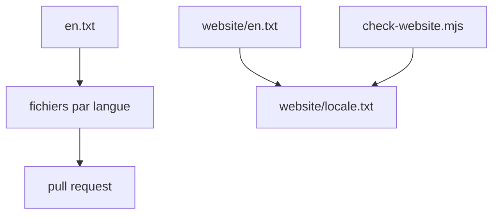

# obsidianmd/obsidian-translations

> Fichiers de traduction de l'application et du site Obsidian, pour traducteurs bénévoles.

## Le problème
Obsidian doit exister dans de nombreuses langues sans que l'équipe traduise tout elle-même.

## Ce que ça fait vraiment
Un fichier `.txt` par langue, en blocs clé, `original=`, `translation=`. Les contributions passent par pull request. Un dossier `website/` traduit les pages marketing, avec un script `check-website.mjs` qui repère les clés manquantes. Le README tient le tableau des langues et de leur état (app, site, aide).

## Comment c'est branché


## Essayer
```bash
node scripts/check-website.mjs
```
Tester dans la console d'Obsidian : `selectLanguageFileLocation()`.

## Coût et pièges
Gratuit. Ne pas traduire les variables comme `{{name}}`. Aucune licence déclarée dans le catalogue.

## Ce que ce n'est pas
Pas un outil de traduction automatique : des ressources à compléter à la main.

## Alternatives
Aucune alternative nommée dans le README.

## Pour toi
À ignorer, sauf si tu veux contribuer au français d'Obsidian : aucun intérêt technique pour la data ou l'IA.

