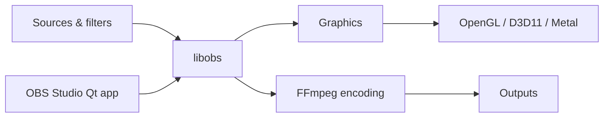

# obsproject/obs-studio

> Free software for video capture, compositing, encoding, recording and streaming, for creators and streamers.

## The problem
Mixing several sources (screen, camera, audio) and broadcasting them live or recording them requires a real-time compositing tool.

## What it actually does
The `libobs` core handles scenes, sources, filters, transitions, encoders and outputs. Features come from plugins: capture on Windows, macOS, Linux (PipeWire), x264/NVENC encoders, RTMP and WebRTC outputs. The Qt interface goes through a frontend API; OpenGL, D3D11 and Metal backends do the rendering.

## How it is wired

## Trying it
The README contains no command: build instructions are at https://github.com/obsproject/obs-studio/wiki/Install-Instructions.

## Cost and gotchas
Free (GPL-2.0 or later). Built with CMake, specific to each platform.

## What it is not
Not an editing tool: it is a capture and streaming tool. The README mainly serves as a gateway to the wiki and the contribution rules.

## Alternatives
No alternative named in the README.

## For you
Worth watching: useful for recording demos or webinars, unrelated to data / AI work proper.
