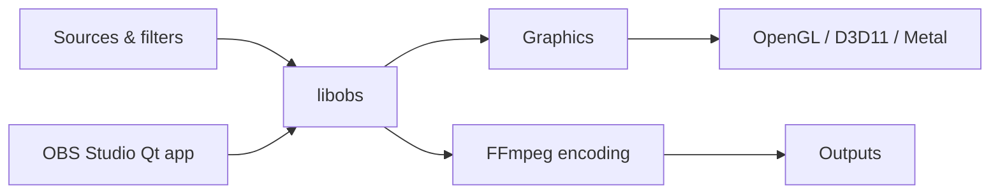

# obsproject/obs-studio

> Logiciel libre de capture, composition, encodage, enregistrement et diffusion vidéo, pour créateurs et streamers.

## Le problème
Mélanger plusieurs sources (écran, caméra, audio) et les diffuser en direct ou les enregistrer demande un outil de composition temps réel.

## Ce que ça fait vraiment
Le cœur `libobs` gère scènes, sources, filtres, transitions, encodeurs et sorties. Les fonctions viennent de plugins : capture Windows, macOS, Linux (PipeWire), encodeurs x264/NVENC, sorties RTMP et WebRTC. L'interface Qt passe par une API de frontend ; des backends OpenGL, D3D11 et Metal font le rendu.

## Comment c'est branché

## Essayer
Le README ne contient pas de commande : instructions de build sur https://github.com/obsproject/obs-studio/wiki/Install-Instructions.

## Coût et pièges
Gratuit (GPL-2.0 ou ultérieure). Compilation par CMake, spécifique à chaque plateforme.

## Ce que ce n'est pas
Pas un éditeur de montage : c'est un outil de capture et de diffusion. Le README sert surtout de porte d'entrée vers le wiki et les règles de contribution.

## Alternatives
Aucune alternative nommée dans le README.

## Pour toi
À surveiller : utile pour enregistrer des démos ou des webinaires, sans rapport avec le travail data / IA proprement dit.

