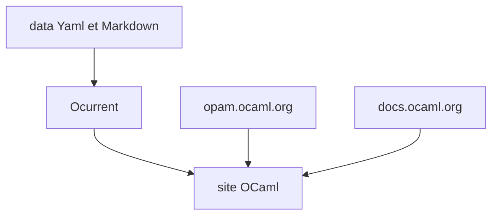

# ocaml/ocaml.org

> Sources of the official ocaml.org website: opam package documentation, learning and news.

## The problem
A language needs a single site that ties together package management, documentation and resources for beginners.

## What it actually does
OCaml site that gathers opam packages and a central documentation source for more than 14,000 packages. Data is in Yaml or Markdown in `./data`, converted into OCaml code via Ocurrent. Responsive and accessible design.

## How it is wired


## Trying it
```bash
make switch
make start
```
Prerequisite: opam installed.

## Cost and gotchas
Free. License present but not identified by GitHub. 205 open issues.

## What it is not
Not a compiler nor a library: the code of a website.

## Alternatives
No alternative named in the README.

## For you
Ignore: unless you contribute to the OCaml ecosystem, this repo does not serve your data or AI work.
