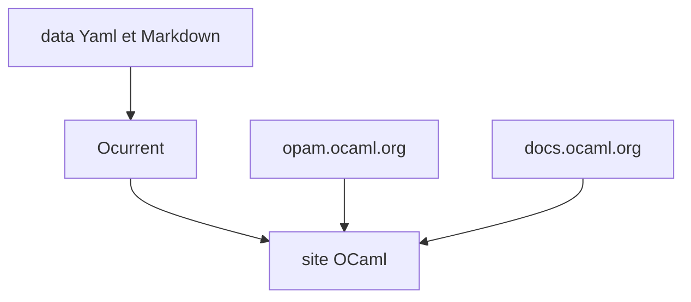

# ocaml/ocaml.org

> Sources du site officiel ocaml.org : documentation de paquets opam, apprentissage et actualités.

## Le problème
Un langage a besoin d'un site unique qui lie gestion de paquets, documentation et ressources pour débutants.

## Ce que ça fait vraiment
Site en OCaml qui regroupe les paquets opam et une source centrale de documentation pour plus de 14 000 paquets. Les données sont en Yaml ou Markdown dans `./data`, converties en code OCaml via Ocurrent. Design réactif et accessible.

## Comment c'est branché


## Essayer
```bash
make switch
make start
```
Prérequis : opam installé.

## Coût et pièges
Gratuit. Licence présente mais non identifiée par GitHub. 205 issues ouvertes.

## Ce que ce n'est pas
Pas un compilateur ni une bibliothèque : le code d'un site web.

## Alternatives
Aucune alternative nommée dans le README.

## Pour toi
À ignorer : sauf contribution à l'écosystème OCaml, ce dépôt ne sert pas ton travail data ou IA.

