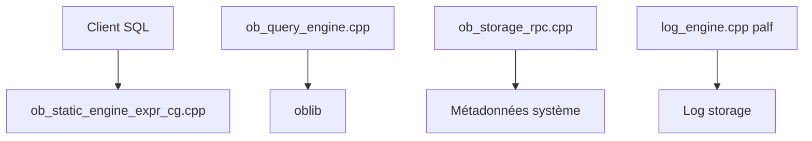

# oceanbase/oceanbase

> MySQL-compatible distributed relational database, developed by Ant Group.

## The problem
A classic MySQL database hits a ceiling in volume and availability; moving to a distributed system means rewriting applications.

## What it actually does
A database distributed on the Paxos protocol, with MySQL compatibility, an HTAP mode for analytics and announced recovery without data loss (RPO = 0). Can be deployed standalone, in Docker or on Kubernetes with ob-operator. The README shows TPC-C and TPC-H figures supplied by the vendor.

## How it is wired


## Trying it
```bash
obd demo
docker run -p 2881:2881 --name oceanbase-ce -e MODE=mini -d oceanbase/oceanbase-ce
docker exec -it oceanbase-ce obclient -h127.0.0.1 -P2881 -uroot
```

## Cost and gotchas
Free. The "all-in-one" install script is downloaded and executed from external storage (curl into bash), Linux only. The announced performance requires a large cluster.

## What it is not
Not a one-click drop-in replacement for MySQL: it is a heavy distributed system. The README figures are the vendor's own.

## Alternatives
No alternative named in the README.

## For you
Worth watching: relevant for large-scale HTAP needs, but oversized for most data pipelines.
