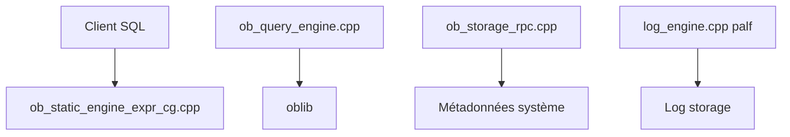

# oceanbase/oceanbase

> Base de données relationnelle distribuée compatible MySQL, développée par Ant Group.

## Le problème
Une base MySQL classique plafonne en volume et en disponibilité ; passer à un système distribué impose de réécrire les applications.

## Ce que ça fait vraiment
Base distribuée sur le protocole Paxos, avec compatibilité MySQL, mode HTAP pour l'analytique et récupération sans perte de données annoncée (RPO = 0). Déploiement possible en autonome, en Docker ou sur Kubernetes avec ob-operator. Le README affiche des chiffres TPC-C et TPC-H fournis par l'éditeur.

## Comment c'est branché


## Essayer
```bash
obd demo
docker run -p 2881:2881 --name oceanbase-ce -e MODE=mini -d oceanbase/oceanbase-ce
docker exec -it oceanbase-ce obclient -h127.0.0.1 -P2881 -uroot
```

## Coût et pièges
Gratuit. Le script d'installation « all-in-one » est téléchargé et exécuté depuis un stockage externe (curl vers bash), Linux uniquement. Les performances annoncées exigent un grand cluster.

## Ce que ce n'est pas
Pas un simple remplaçant de MySQL en un clic : c'est un système distribué lourd. Les chiffres du README sont ceux de l'éditeur.

## Alternatives
Aucune alternative nommée dans le README.

## Pour toi
À surveiller : pertinent pour des besoins de HTAP à grande échelle, mais surdimensionné pour la plupart des pipelines data.

