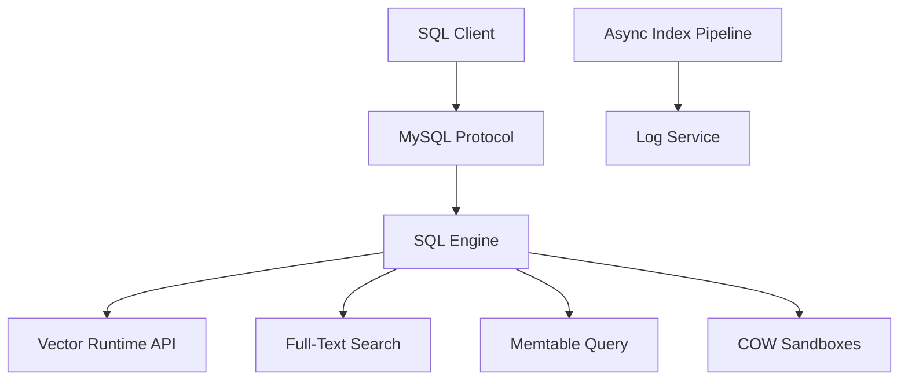

# oceanbase/seekdb

> MySQL-compatible database with hybrid vector, text and SQL search, designed as state memory for agents.

## The problem
An agent writes memories continuously and reads them back a few milliseconds later; a separate vector database adds merging code and latency spikes.

## What it actually does
An ACID transactional database, derived from the OceanBase SQL engine, in embedded or server mode. A single query combines vector, full-text and filters. `FORK DATABASE` creates a copy-on-write sandbox, `MERGE TABLE` brings it back. The README claims 1,523 QPS; this figure is the author's, and the supplied code does not verify fork or asynchronous indexing.

## How it is wired


## Trying it
```bash
pip install -U pyseekdb
docker run -d --name seekdb -p 2881:2881 -p 2886:2886 -v ./data:/var/lib/oceanbase oceanbase/seekdb:latest
```

## Cost and gotchas
Free, Apache-2.0. The trial cloud mode lasts 7 days without a card. Building from source requires a full C++ toolchain. 760 open issues.

## What it is not
Not a simple vector module: it is a full database. The benchmarks against Milvus and Elasticsearch are not reproduced here. Python 3.11+ and Node 22+ for the embedded bindings.

## Alternatives
- Milvus: compared on write and search throughput.
- Elasticsearch: compared on text search and P99 latency.

## For you
Worth watching: hybrid search in SQL and sandboxes address a real agent-memory need, to be confirmed by your own measurements.
