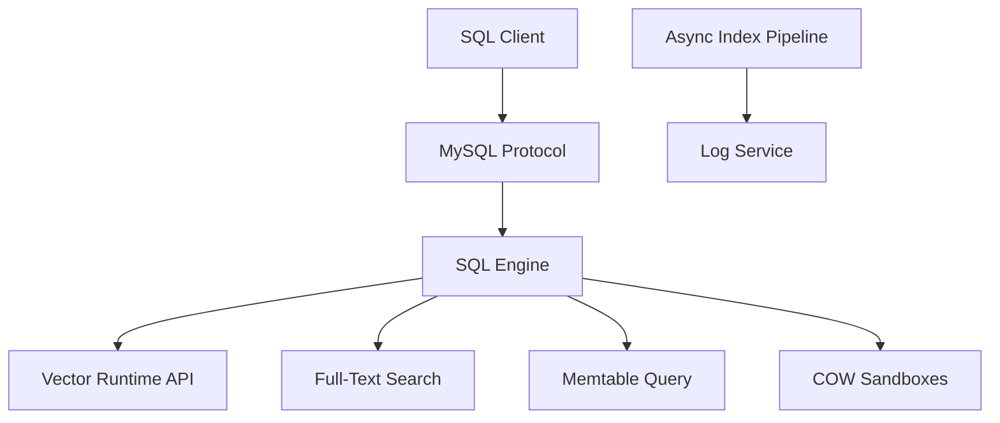

# oceanbase/seekdb

> Base compatible MySQL avec recherche hybride vecteur, texte et SQL, pensée comme mémoire d'état pour agents.

## Le problème
Un agent écrit des souvenirs en continu et les relit quelques millisecondes plus tard ; une base vectorielle séparée ajoute du code de fusion et des pics de latence.

## Ce que ça fait vraiment
Une base transactionnelle ACID, issue du moteur SQL d'OceanBase, en mode embarqué ou serveur. Une seule requête combine vecteur, texte intégral et filtres. `FORK DATABASE` crée un bac à sable en copie sur écriture, `MERGE TABLE` le rapatrie. Le README annonce 1 523 QPS ; ce chiffre est celui de l'auteur et le code fourni ne vérifie pas fork ni indexation asynchrone.

## Comment c'est branché


## Essayer
```bash
pip install -U pyseekdb
docker run -d --name seekdb -p 2881:2881 -p 2886:2886 -v ./data:/var/lib/oceanbase oceanbase/seekdb:latest
```

## Coût et pièges
Gratuit, Apache-2.0. Le mode cloud d'essai dure 7 jours sans carte. Le build depuis les sources demande une chaîne d'outils C++ complète. 760 issues ouvertes.

## Ce que ce n'est pas
Pas un simple module vectoriel : c'est une base complète. Les benchmarks contre Milvus et Elasticsearch ne sont pas reproduits ici. Python 3.11+ et Node 22+ pour les liaisons embarquées.

## Alternatives
- Milvus : comparé pour le débit d'écriture et de recherche.
- Elasticsearch : comparé pour la recherche texte et la latence P99.

## Pour toi
À surveiller : la recherche hybride en SQL et les bacs à sable répondent à un vrai besoin de mémoire d'agent, à confirmer par tes propres mesures.

