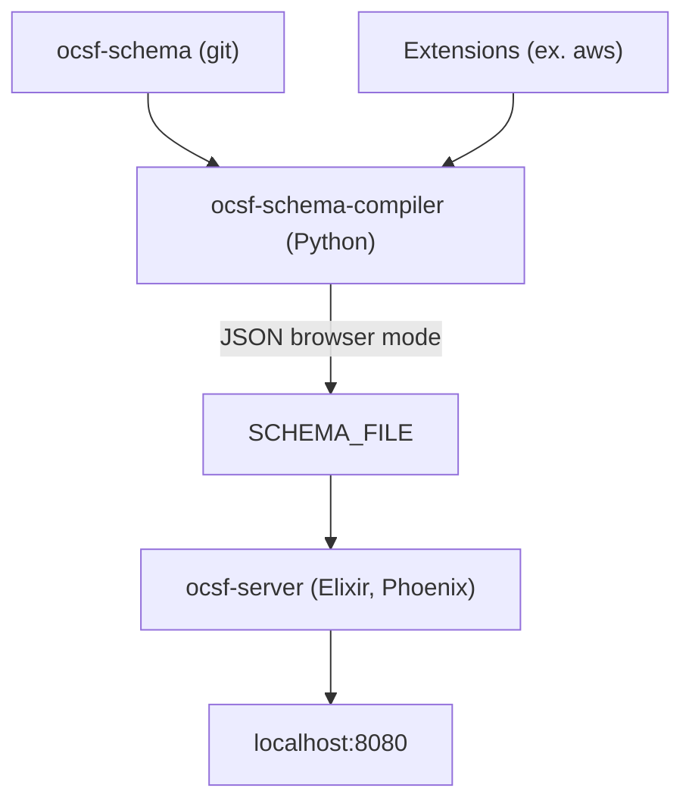

# ocsf/ocsf-server

> Elixir HTTP server to browse the OCSF cybersecurity schema, locally or via container.

## The problem
The Open Cybersecurity Schema Framework schema is large and hard to read without a dedicated browser.

## What it actually does
The server, written in Elixir with Phoenix, displays a compiled OCSF schema. The ocsf-schema-compiler, a Python package, produces a JSON in browser mode, which exceeds 45 MB. The server reads this file via SCHEMA_FILE. A base schema and private extensions compile together. Several versions require several instances.

## How it is wired


## Trying it
```bash
docker build -t ocsf-server .
docker run -it --rm --volume ~/ocsf-compiled-schemas:/app/schemas -e SCHEMA_FILE="/app/schemas/ocsf-schema-main-browser.json" -p 8080:8080 ocsf-server
```

## Cost and gotchas
Free, but you need git, Python 3.14 or later for the compiler, and Docker or Elixir. The schema must be compiled before launching the server. Hosting several versions is described as complicated.

## What it is not
It is not a detection or log analysis tool: it only presents the schema. It does not natively handle multiple versions.

## Alternatives
- schema.ocsf.io: public hosted version of the same server, with nothing to install.

## For you
Watch: useful if you normalise security logs to OCSF, but the public site is enough to consult the schema.
