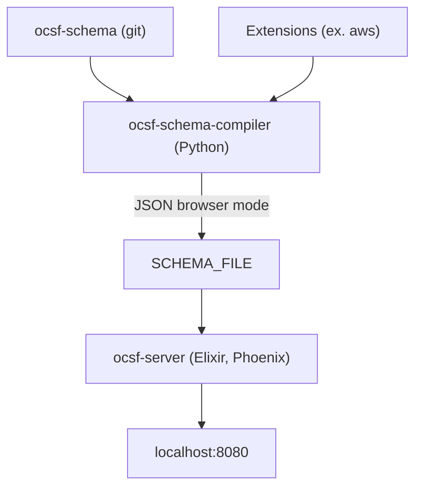

# ocsf/ocsf-server

> Serveur HTTP Elixir pour parcourir le schéma OCSF de cybersécurité, en local ou via conteneur.

## Le problème
Le schéma Open Cybersecurity Schema Framework est volumineux et difficile à lire sans navigateur dédié.

## Ce que ça fait vraiment
Le serveur, écrit en Elixir avec Phoenix, affiche un schéma OCSF compilé. Le compilateur ocsf-schema-compiler, un paquet Python, produit un JSON en mode browser, qui dépasse 45 Mo. Le serveur lit ce fichier via SCHEMA_FILE. Un schéma de base et des extensions privées se compilent ensemble. Plusieurs versions demandent plusieurs instances.

## Comment c'est branché


## Essayer
```bash
docker build -t ocsf-server .
docker run -it --rm --volume ~/ocsf-compiled-schemas:/app/schemas -e SCHEMA_FILE="/app/schemas/ocsf-schema-main-browser.json" -p 8080:8080 ocsf-server
```

## Coût et pièges
Gratuit, mais il faut git, Python 3.14 ou plus pour le compilateur, et Docker ou Elixir. Le schéma doit être compilé avant de lancer le serveur. Héberger plusieurs versions est décrit comme compliqué.

## Ce que ce n'est pas
Ce n'est pas un outil de détection ou d'analyse de logs : il ne fait que présenter le schéma. Il ne gère pas nativement plusieurs versions.

## Alternatives
- schema.ocsf.io : version publique hébergée du même serveur, sans rien installer.

## Pour toi
À surveiller : utile si tu normalises des logs de sécurité en OCSF, mais le site public suffit pour consulter le schéma.

