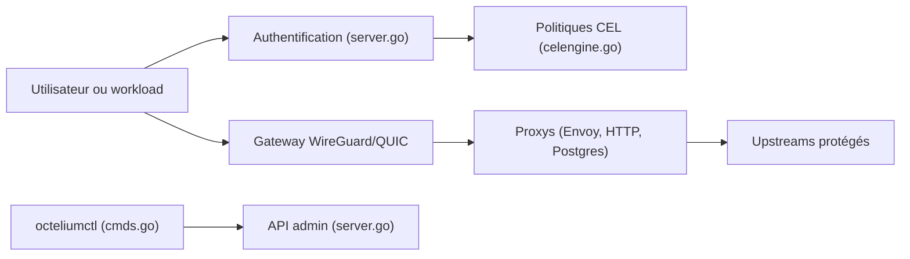

# octelium/octelium

> Self-hosted zero trust access platform: VPN, ZTNA, API and AI gateway, on Kubernetes.

## The problem
Giving access to private resources and protected APIs without distributing keys or opening ports requires several separate tools.

## What it actually does
A Kubernetes cluster runs identity-aware proxies. Clients connect over WireGuard/QUIC, or access resources clientlessly. Per-request access control with CEL and OPA, secretless access (API keys, SSH, Postgres/MySQL databases, mTLS), OIDC/SAML authentication with FIDO2, TOTP and TPM, OpenTelemetry audit, container deployment as services, Cordium sandboxes. Declarative management via `octeliumctl`.

## How it is wired


## Trying it
```bash
curl -o install-cluster.sh https://octelium.com/install-cluster.sh
chmod +x install-cluster.sh
./install-cluster.sh --domain <DOMAIN>
curl -fsSL https://octelium.com/install.sh | bash
```

## Cost and gotchas
Free; a Linux VM with at least 2 GB of RAM and 20 GB of disk for one node. AGPL-3.0 license; enterprise features (dashboard, SIEM, SCIM) are under a separate source-available license. No external contributions accepted, a single owner behind the project.

## What it is not
Not a simple layer-3 VPN: it is an L7 proxy architecture. Version 1.0 not yet released, according to the README.

## Alternatives
Tailscale, Twingate, OpenVPN Access Server, Cloudflare Access, Teleport, ngrok, Kong (cited by the README).

## For you
Worth watching if you need to securely expose model APIs or MCP agents; the operational effort of a Kubernetes cluster is substantial for individual use.
