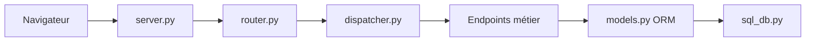

# odoo/odoo

> Open source suite of business web applications (CRM, accounting, inventory…), for companies and integrators.

## The problem
Making CRM, invoicing, warehouse and projects coexist in separate tools that do not talk to each other.

## What it actually does
Offers applications that can be installed separately or together: CRM, website, e-commerce, warehouse, projects, accounting, point of sale, HR, marketing, manufacturing. According to the code: browser request, HTTP routing, dispatching, business endpoints, then ORM and database. The README refers to the documentation for installation.

## How it is wired

## Trying it
No command documented in the README: install via Odoo's documentation.

## Cost and gotchas
The README does not detail the offerings. A database is required. More than 10,000 open issues: heavy backlog.

## What it is not
Not a data or AI tool: it is an ERP. The README does not say what remains outside the community edition. License present but not identified by GitHub: to be checked.

## Alternatives
No alternative named in the README.

## For you
Watch: outside your data/AI scope, unless you extract data from an ERP; check the license before any deployment.
