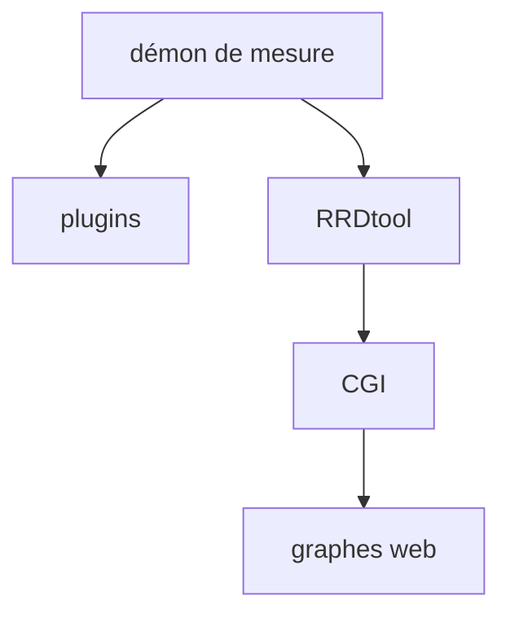

# oetiker/SmokePing

> Network latency measurement, graphing and alerting system, in Perl, for network administrators.

## The problem
Knowing whether a network link is slow or unstable requires tracking latency over time, not a one-off ping.

## What it actually does
A daemon schedules the latency measurements; a CGI displays the graphs. Extensible through plugins, configurable by a file and a web template, with an RRDtool front end. Handles dynamic IPs (cable, ADSL). Minimal README: the rest is not documented here.

## How it is wired

## Trying it
No command documented in the README. See the project documentation.

## Cost and gotchas
Free. Installation and configuration are not described in the README; Perl required.

## What it is not
Neither a modern observability tool (no application metrics), nor a turnkey solution documented in this README.

## Alternatives
No alternative named in the README.

## For you
Worth watching: useful for tracking the latency of links or endpoints that serve models, but outside the data/AI core and the README is too thin to decide further.
