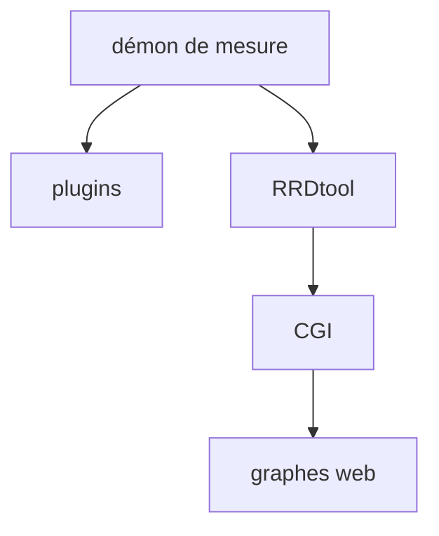

# oetiker/SmokePing

> Système de mesure, graphes et alertes de latence réseau, en Perl, pour administrateurs réseau.

## Le problème
Savoir si une liaison réseau est lente ou instable demande un suivi de latence dans le temps, pas un ping ponctuel.

## Ce que ça fait vraiment
Un démon organise les mesures de latence ; un CGI affiche les graphes. Extensible par plugins, configurable par un fichier et un gabarit web, frontal RRDtool. Gère les IP dynamiques (câble, ADSL). README minimal : le reste est non documenté ici.

## Comment c'est branché

## Essayer
Aucune commande documentée dans le README. Voir la documentation du projet.

## Coût et pièges
Gratuit. Installation et configuration non décrites dans le README ; Perl requis.

## Ce que ce n'est pas
Ni outil d'observabilité moderne (pas de métriques applicatives), ni solution clé en main documentée dans ce README.

## Alternatives
Aucune alternative nommée dans le README.

## Pour toi
À surveiller : utile pour tracer la latence de liens ou d'endpoints qui servent des modèles, mais hors cœur data/IA et README trop mince pour trancher plus.

