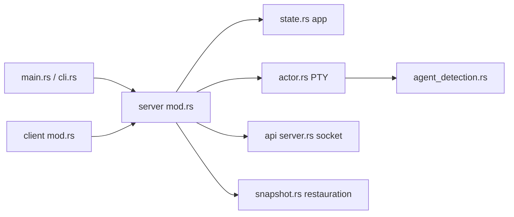

# ogulcancelik/herdr

> A Rust-based terminal multiplexer that keeps your code agents alive and reports any that are blocked.

## The problem
Several agents are working on separate terminals: this means that the SSH session is lost upon disconnection, and it's unclear which agent is waiting for a response.

## What it actually does
A local server manages the PTYs, workspaces, and layout; the client connects to and disconnects from it (`ctrl+b q`). Each panel is marked as "working," "blocked," or "idle" using TOML-based detection manifests. A versioned API and CLI allow agents to create panels or manage them. Plugins are available through a marketplace.

## How it is wired


## Trying it
```bash
curl -fsSL https://herdr.dev/install.sh | sh
herdr
# ctrl+b q pour détacher, `herdr` pour rattacher
cargo build --release
```

## Cost and gotchas
Free, binary-only. After restarting the machine, the layout is restored, but the original processes do not survive. Limited support for known agents (claude code, codex, cursor, opencode, grok…).

## What it is not
It is neither an agent nor a wrapper; it possesses the terminals but does not replace the agents. It is not a web interface.

## Alternatives
There is no alternative mentioned in the README (it works by using prefix keys, similar to tmux).

## For you
Monitoring: This is interesting if you run multiple agents in parallel on a remote server, but it's not directly relevant for data work unless you only run one agent at a time.
