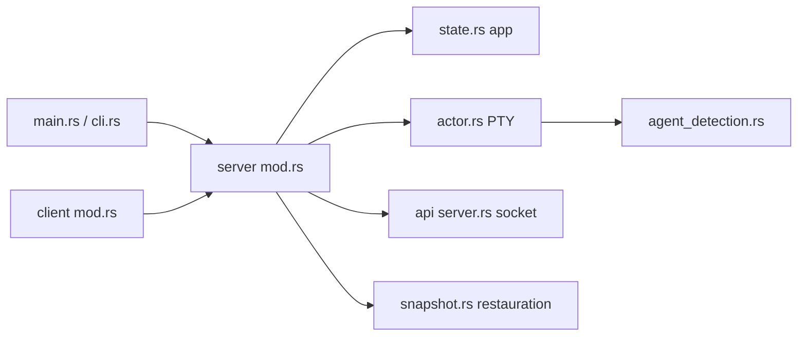

# ogulcancelik/herdr

> Un multiplexeur de terminal en Rust qui garde tes agents de code en vie et signale celui qui bloque.

## Le problème
Plusieurs agents tournent dans des terminaux dispersés : on perd la session à la déconnexion SSH et on ignore lequel attend une réponse.

## Ce que ça fait vraiment
Un serveur local détient les PTY, les espaces de travail et la mise en page ; le client s'y rattache et se détache (`ctrl+b q`). Chaque panneau est marqué working, blocked ou idle, via des manifestes de détection TOML. Une API socket versionnée et un CLI laissent les agents créer des panneaux ou s'attendre. Plugins via une place de marché.

## Comment c'est branché


## Essayer
```bash
curl -fsSL https://herdr.dev/install.sh | sh
herdr
# ctrl+b q pour détacher, `herdr` pour rattacher
cargo build --release
```

## Coût et pièges
Gratuit, binaire unique. Après redémarrage de la machine, la mise en page est restaurée mais les processus d'origine ne survivent pas. Support limité aux agents connus (claude code, codex, cursor, opencode, grok…).

## Ce que ce n'est pas
Pas un agent ni un wrapper : il possède les terminaux mais ne remplace pas les agents. Pas une interface web.

## Alternatives
Aucune alternative nommée dans le README (il se positionne face à tmux par ses touches préfixées).

## Pour toi
Surveiller : intéressant si tu lances plusieurs agents en parallèle sur serveur distant, sans intérêt direct pour un travail data tant que tu n'en lances qu'un à la fois.

