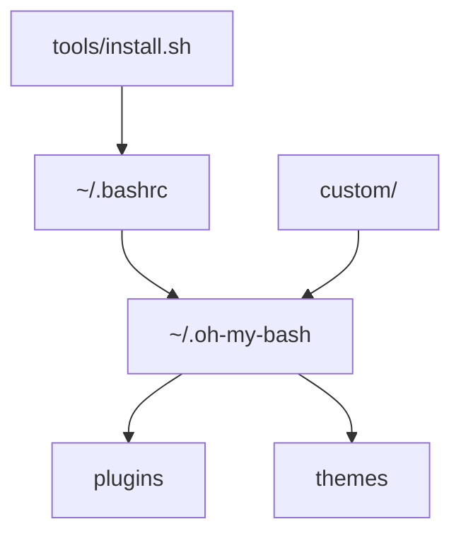

# ohmybash/oh-my-bash

> Community bash configuration framework: plugins, themes and aliases.

## The problem
A bare `.bashrc` is austere and hard to maintain if you want a colored prompt, completions and shortcuts.

## What it actually does
It replaces `~/.bashrc` with a template that loads plugins, aliases, completions and over a hundred themes. Choices are made in `.bashrc` (`plugins=(...)`, `OSH_THEME`). It allows a random theme, a non-interactive or system-wide installation, and overrides in `custom/`. Uninstall with `uninstall_oh_my_bash`.

## How it is wired


## Trying it
```bash
bash -c "$(curl -fsSL https://raw.githubusercontent.com/ohmybash/oh-my-bash/master/tools/install.sh)"
bash -c "$(curl -fsSL https://raw.githubusercontent.com/ohmybash/oh-my-bash/master/tools/install.sh)" --unattended
uninstall_oh_my_bash
```

## Cost and gotchas
Free. Installation replaces `~/.bashrc` (backed up as `.bashrc.omb-TIMESTAMP`); check that `~/.bash_profile` sources `.bashrc`. Some themes require a Powerline font.

## What it is not
Not a development productivity tool beyond terminal comfort. Works mostly on macOS and Linux.

## Alternatives
oh-my-zsh: the README points to its wiki for themes; zsh version.

## For you
Worth watching: terminal comfort with no effect on data/AI work, to test on a non-critical machine.
