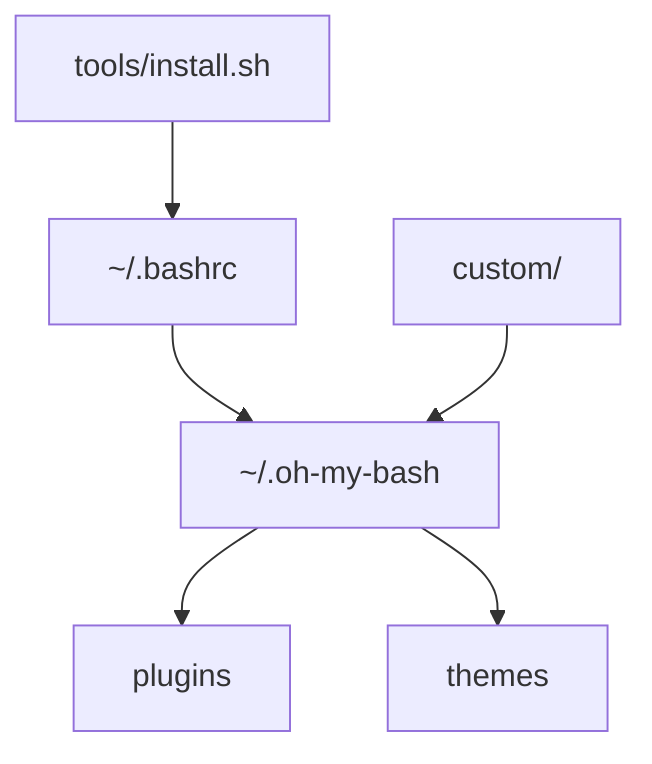

# ohmybash/oh-my-bash

> Framework communautaire de configuration bash : plugins, thèmes et alias.

## Le problème
Un `.bashrc` brut est austère et difficile à maintenir pour avoir invite colorée, complétions et raccourcis.

## Ce que ça fait vraiment
Il remplace `~/.bashrc` par un modèle qui charge des plugins, alias, complétions et plus de cent thèmes. Les choix se font dans `.bashrc` (`plugins=(...)`, `OSH_THEME`). Il permet un thème aléatoire, une installation sans interaction ou système, et des surcharges dans `custom/`. Désinstallation par `uninstall_oh_my_bash`.

## Comment c'est branché


## Essayer
```bash
bash -c "$(curl -fsSL https://raw.githubusercontent.com/ohmybash/oh-my-bash/master/tools/install.sh)"
bash -c "$(curl -fsSL https://raw.githubusercontent.com/ohmybash/oh-my-bash/master/tools/install.sh)" --unattended
uninstall_oh_my_bash
```

## Coût et pièges
Gratuit. L'installation remplace `~/.bashrc` (sauvegardé en `.bashrc.omb-TIMESTAMP`) ; vérifier que `~/.bash_profile` source `.bashrc`. Certains thèmes demandent une police Powerline.

## Ce que ce n'est pas
Pas un outil de productivité de développement au-delà du confort du terminal. Fonctionne surtout sous macOS et Linux.

## Alternatives
oh-my-zsh : le README renvoie à son wiki pour les thèmes ; version pour zsh.

## Pour toi
À surveiller : confort de terminal sans effet sur le travail data/IA, à tester sur une machine non critique.

