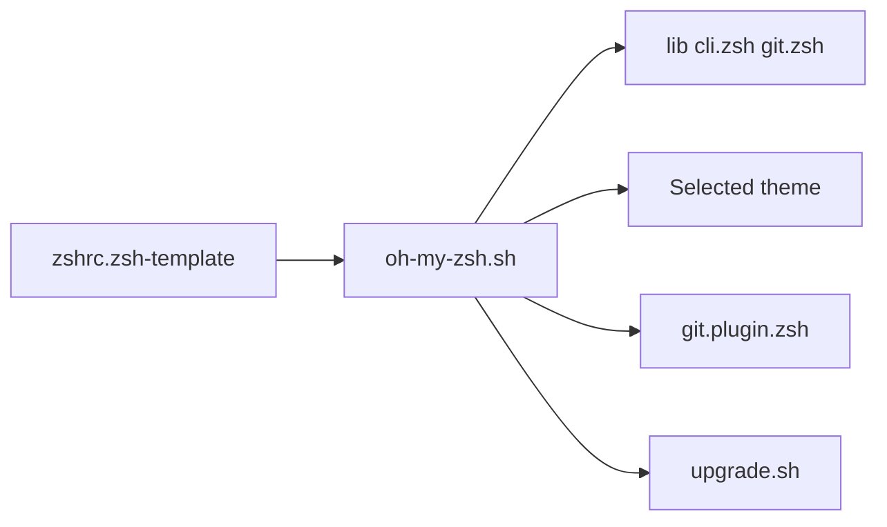

# ohmyzsh/ohmyzsh

> Community framework for configuring zsh: plugins, themes, and aliases for your terminal.

## The problem
Setting up a Zsh environment can be quite complex, and manually configuring completion, aliases, and a prompt takes a significant amount of time.

## What it actually does
`oh-my-zsh.sh`, which is loaded from `~/.zshrc`, loads libraries (completion, git, history, prompt), a theme, and the chosen plugins. Over 150 themes and hundreds of plugins are provided, including git and docker. An asynchronous git prompt is experimental, and `omz shellsaver` adds screen savers. Updates are available through the local git repository.

## How it is wired


## Trying it
```bash
sh -c "$(curl -fsSL https://raw.githubusercontent.com/ohmyzsh/ohmyzsh/master/tools/install.sh)"
vi ~/.zshrc
```

## Cost and gotchas
Free. Prerequisites: zsh, curl or wget, git. The old `.zshrc` file is renamed to `.zshrc.pre-oh-my-zsh`. Many themes require the Nerd Font.

## What it is not
Not a terminal theme: it does not handle colors or fonts. The asynchronous prompt is experimental and incompatible with some plugin managers.

## Alternatives
No alternative is specified in the README file.

## For you
This is a good option if you use the Zsh shell: it provides immediate comfort, without affecting your work with data or MLOps.
