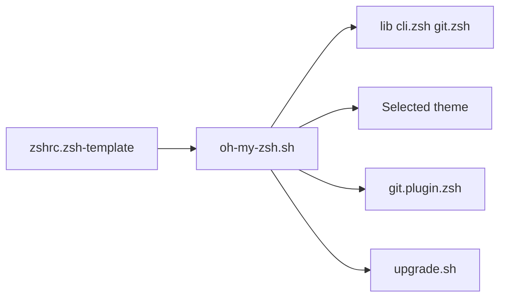

# ohmyzsh/ohmyzsh

> Framework communautaire de configuration de zsh : plugins, thèmes et alias pour ton terminal.

## Le problème
Un zsh nu est austère, et assembler complétion, alias git et prompt à la main prend du temps.

## Ce que ça fait vraiment
`oh-my-zsh.sh`, chargé depuis `~/.zshrc`, charge des bibliothèques (complétion, git, historique, prompt), un thème et les plugins choisis. Plus de 150 thèmes et des centaines de plugins sont fournis, dont git et docker. Un prompt git asynchrone est expérimental, et `omz shellsaver` ajoute des économiseurs d'écran. Mise à jour via le dépôt git local.

## Comment c'est branché


## Essayer
```bash
sh -c "$(curl -fsSL https://raw.githubusercontent.com/ohmyzsh/ohmyzsh/master/tools/install.sh)"
vi ~/.zshrc
```

## Coût et pièges
Gratuit. Prérequis : zsh, curl ou wget, git. L'ancien `.zshrc` est renommé en `.zshrc.pre-oh-my-zsh`. Beaucoup de thèmes demandent une police Nerd Font.

## Ce que ce n'est pas
Pas un thème de terminal : il ne gère pas les couleurs ni la police. Le prompt asynchrone est expérimental et incompatible avec certains gestionnaires de plugins.

## Alternatives
Aucune alternative nommée dans le README.

## Pour toi
À adopter si tu vis dans un shell zsh : gain de confort immédiat, sans lien avec ton travail data ou MLOps.

