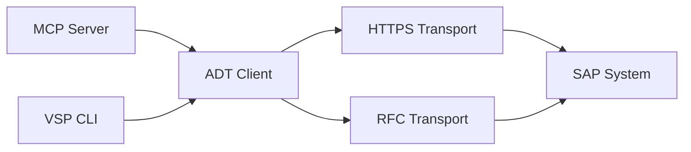

# oisee/vibing-steampunk

> MCP/CLI bridge to SAP ADT so an AI assistant can read, write, debug and deploy ABAP code.

## The problem
An AI agent cannot work on a SAP system without going through Eclipse ADT and its stateful sessions.

## What it actually does
A single Go binary exposes MCP tools (one `SAP` tool in the recommended mode, 100 or 151 in the detailed modes) and a CLI. It speaks ADT over HTTPS and classic RFC without an SDK. It reads and edits sources, runs tests and ATC, debugs (breakpoints, variables), reads dumps, logs, jobs and spools, and offers package analyses. An LSP server is included.

## How it is wired


## Trying it
```bash
curl -LO https://github.com/oisee/vibing-steampunk/releases/latest/download/vsp-linux-amd64
chmod +x vsp-linux-amd64
./vsp -s dev search "zcl_*" --type CLAS --max 50
vsp --mode hyperfocused
```

## Cost and gotchas
Free, but it requires a SAP system with ADT enabled (7.50+) and credentials. The README warns that changing variables mid-debugging alters the real execution, database writes included.

## What it is not
Not a general-purpose tool: SAP/ABAP only. Some features are marked as research or unfinished (AMDP, watchpoints).

## Alternatives
The README cites abap-adt-api (Marcello Urbani) and mcp-abap-adt (Mario Andreschak), from which it derives.

## For you
Ignore unless you work on SAP: the tool is rich but its domain is ABAP, far from a data/AI/MLOps profile.
