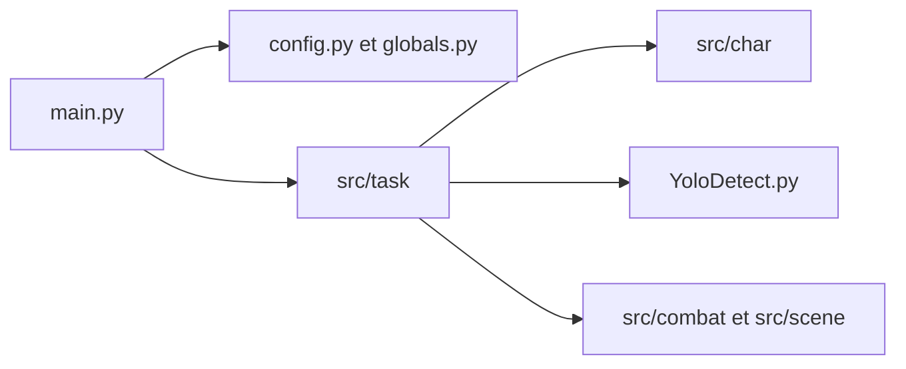

# ok-oldking/ok-wuthering-waves

> Image-recognition automation of the game Wuthering Waves on Windows, with a background mode.

## The problem
The game's repetitive tasks (combat, gathering, daily quests) eat up play time.

## What it actually does
Windows program based on the ok-script framework: on-screen element detection (YOLO ONNX model), character management, automated tasks (combat, gathering, login), interaction through simulated win32 inputs, hidden-window execution with sound muted. README in Chinese and English.

## How it is wired


## Trying it
```bash
pip install -r requirements.txt --upgrade
python main.py
python main_debug.py
ok-ww.exe -t 1 -e
```

## Cost and gotchas
Free. The README quotes the game publisher: account ban or freeze is possible for macros and third-party tools; the user assumes all risks.

## What it is not
Not a general AI tool: the vision part serves a single game. The README claims to give no unfair advantage, which the quoted publisher contradicts in its policy.

## Alternatives
Neighboring projects based on ok-script, listed in the README: ok-genshin-impact, ok-gf2, ok-starrailassistant.

## For you
To ignore: game automation with a risk of account ban, with no data/AI/MLOps use.
