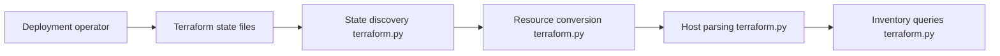

# okd-project/okd

> Community distribution of Kubernetes, the basis of OpenShift, with the landing and documentation repo.

## The problem
Getting a complete Kubernetes with console, registry, authentication and default security on cloud or bare metal.

## What it actually does
This repo is mostly a community entry point: README, FAQ and known issues. The sampled architecture code is limited to a Terraform dynamic inventory script for OpenStack UPI. Installation goes through the `openshift-install` binary downloaded from the releases. The README describes features (S2I, Operator Hub, non-root security policy) without the code being here.

## How it is wired


## Trying it
```
openshift-install create cluster
openshift-install destroy cluster
```

## Cost and gotchas
Cloud credentials and a public DNS zone are required before installation. AWS is the platform recommended in the README. Expect about 30 minutes of installation and the cost of cloud resources. The README still cites IRC freenode and Bugzilla "soon": dated mentions.

## What it is not
This repo is not the OKD platform itself: the README points to the components in the `openshift` organization.

## Alternatives
The README names no alternative.

## For you
Ignore: a heavy enterprise Kubernetes platform, off-topic for a data or AI profile unless you already operate an OpenShift fleet.
