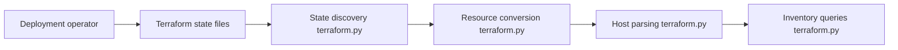

# okd-project/okd

> Distribution communautaire de Kubernetes, base d'OpenShift, avec le dépôt d'accueil et de documentation.

## Le problème
Obtenir un Kubernetes complet avec console, registre, authentification et sécurité par défaut sur cloud ou bare metal.

## Ce que ça fait vraiment
Ce dépôt est surtout un point d'entrée communautaire : README, FAQ et problèmes connus. Le code d'architecture échantillonné se limite à un script d'inventaire dynamique Terraform pour OpenStack UPI. L'installation passe par le binaire `openshift-install` téléchargé depuis les releases. Le README décrit des fonctions (S2I, Operator Hub, politique de sécurité non-root) sans que le code soit ici.

## Comment c'est branché


## Essayer
```
openshift-install create cluster
openshift-install destroy cluster
```

## Coût et pièges
Identifiants cloud et zone DNS publique requis avant l'installation. AWS est la plateforme recommandée dans le README. Compter environ 30 minutes d'installation et le coût des ressources cloud. Le README cite encore IRC freenode et Bugzilla « bientôt » : des mentions datées.

## Ce que ce n'est pas
Ce dépôt n'est pas la plateforme OKD elle-même : le README renvoie aux composants dans l'organisation `openshift`.

## Alternatives
Le README ne nomme pas d'alternative.

## Pour toi
Ignorer : plateforme Kubernetes d'entreprise lourde, hors sujet pour un profil data ou IA sauf si tu opères déjà un parc OpenShift.

