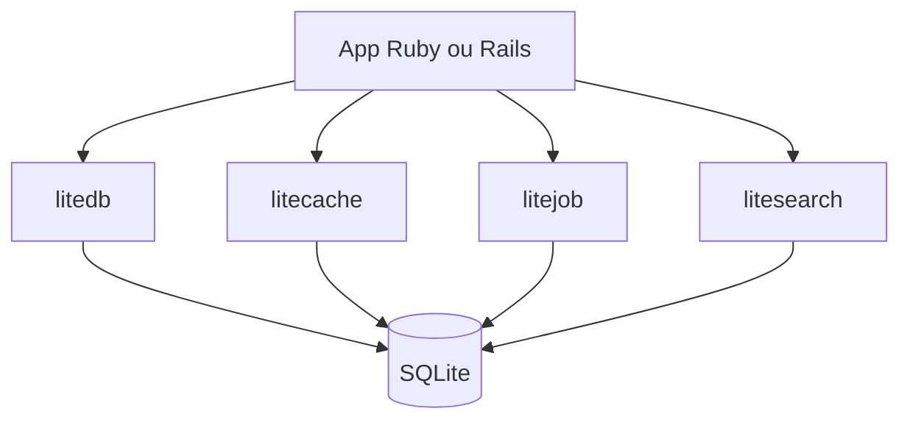

# oldmoe/litestack

> Ruby gem that replaces the database, cache, job queue, search and pub/sub with SQLite, for Rails apps.

## The problem
A typical Rails app needs several servers: a SQL database, Redis, Sidekiq, a search engine. Each one costs memory and administration.

## What it actually does
Six components on top of SQLite: litedb, litecache, litejob, litecable, litesearch (full text) and litemetric with its Liteboard dashboard. Integration with ActiveRecord, Sequel, ActiveJob and ActionCable. Switches to fibers if Async or Polyphony are present.

## How it is wired
Simplified diagram based on the sheet, no diagram provided.


## Trying it
```bash
bundle add litestack
rails generate litestack:install
liteboard -h
```

## Cost and gotchas
Free, no external service. Litecable is only tested in local (inline) mode according to the README. Everything relies on SQLite files on a single machine.

## What it is not
Not a multi-server solution: the cache and the queue are local to the machine. Not data-science oriented at all. Last push in December 2024.

## Alternatives
No alternative named in the README other than the services it replaces: PostgreSQL, Redis, Sidekiq, Elasticsearch.

## For you
Ignore: Ruby/Rails stack, unrelated to a data / AI / MLOps profile, and activity is declining.
