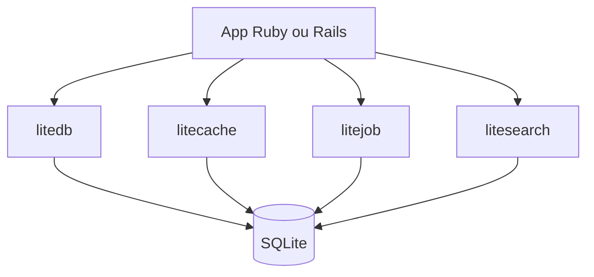

# oldmoe/litestack

> Gem Ruby qui remplace base, cache, file de jobs, recherche et pub/sub par SQLite, pour apps Rails.

## Le problème
Une app Rails typique demande plusieurs serveurs : base SQL, Redis, Sidekiq, moteur de recherche. Chacun coûte en mémoire et en administration.

## Ce que ça fait vraiment
Six composants sur SQLite : litedb, litecache, litejob, litecable, litesearch (texte intégral) et litemetric avec son tableau Liteboard. Intégration ActiveRecord, Sequel, ActiveJob et ActionCable. Bascule vers des fibres si Async ou Polyphony sont présents.

## Comment c'est branché
Schéma simplifié d'après la fiche, sans diagramme fourni.


## Essayer
```bash
bundle add litestack
rails generate litestack:install
liteboard -h
```

## Coût et pièges
Gratuit, sans service externe. Litecable n'est testé qu'en mode local (inline) selon le README. Tout repose sur des fichiers SQLite sur une seule machine.

## Ce que ce n'est pas
Pas une solution multi-serveurs : le cache et la file sont locaux à la machine. Pas du tout orienté data science. Dernier push en décembre 2024.

## Alternatives
Aucune alternative nommée dans le README en dehors des services remplacés : PostgreSQL, Redis, Sidekiq, Elasticsearch.

## Pour toi
À ignorer : stack Ruby/Rails, sans lien avec un profil data / IA / MLOps, et activité en baisse.

