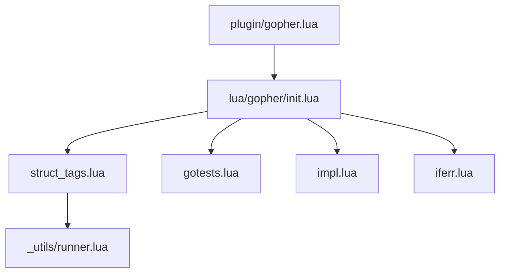

# olexsmir/gopher.nvim

> Minimalist Neovim plugin in Lua that adds Go tooling commands: tags, tests, impl, iferr.

## The problem
Go tools (`gomodifytags`, `gotests`, `impl`, `iferr`) are used from the command line, outside the editor.

## What it actually does
Exposes commands such as `:GoTagAdd`, `:GoTestAdd`, `:GoImpl`, `:GoIfErr`, `:GoJson` (JSON to Go struct), `:GoNew`, `:GoGet`, `:GoMod`. `_utils/runner.lua` runs the external tools, installed by `:GoInstallDeps`. It is not an LSP tool.

## How it is wired


## Trying it
```bash
# init.lua :
# vim.pack.add { "https://github.com/olexsmir/gopher.nvim" }
# require("gopher").setup {}
:GoInstallDeps
:GoTagAdd json
:GoImpl io.Reader
```

## Cost and gotchas
Neovim 0.10+, Go, the `go` tree-sitter parser. Development of new features happens on the `develop` branch.

## What it is not
Not a language server, nor a replacement for `gopls`.

## Alternatives
No alternative named in the README.

## For you
Ignore: useful to those who code in Go under Neovim, outside your scope.
