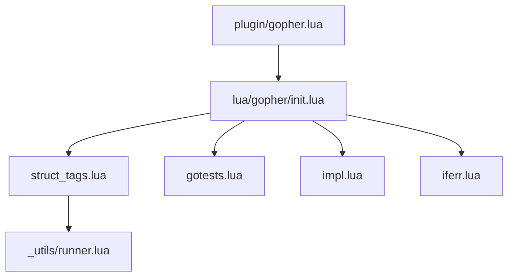

# olexsmir/gopher.nvim

> Plugin Neovim minimaliste en Lua qui ajoute des commandes d'outillage Go : tags, tests, impl, iferr.

## Le problème
Les outils Go (`gomodifytags`, `gotests`, `impl`, `iferr`) s'utilisent en ligne de commande, hors de l'éditeur.

## Ce que ça fait vraiment
Expose des commandes comme `:GoTagAdd`, `:GoTestAdd`, `:GoImpl`, `:GoIfErr`, `:GoJson` (JSON vers structure Go), `:GoNew`, `:GoGet`, `:GoMod`. `_utils/runner.lua` exécute les outils externes, installés par `:GoInstallDeps`. Ce n'est pas un outil LSP.

## Comment c'est branché


## Essayer
```bash
# init.lua :
# vim.pack.add { "https://github.com/olexsmir/gopher.nvim" }
# require("gopher").setup {}
:GoInstallDeps
:GoTagAdd json
:GoImpl io.Reader
```

## Coût et pièges
Neovim 0.10+, Go, parseur tree-sitter `go`. Le développement des fonctions nouvelles se fait sur la branche `develop`.

## Ce que ce n'est pas
Pas un serveur de langage, ni un remplaçant de `gopls`.

## Alternatives
Aucune alternative nommée dans le README.

## Pour toi
Ignorer : utile à qui code en Go sous Neovim, hors de ton périmètre.

