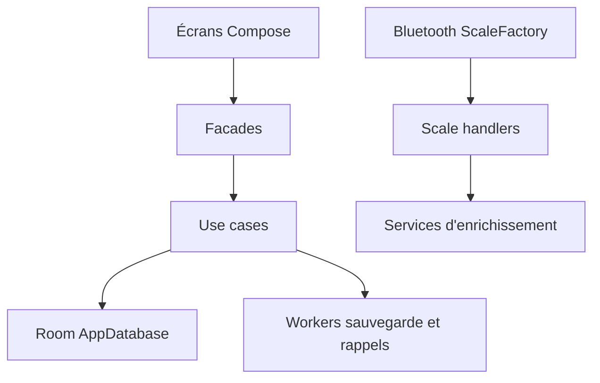

# oliexdev/openScale

> Free Android application for tracking weight and body measurements, with Bluetooth scales.

## The problem
Connected-scale applications require an account and send the data to the cloud.

## What it actually does
Tracks weight, BMI, fat, water, muscle, with charts, a table and an assessment based on age and height. Retrieves measurements from many Bluetooth scales through brand-specific handlers. Local storage (Room), CSV import and export, multi-user, home-screen widget, no internet permission.

## How it is wired

## Trying it
No documented command: install the application via Google Play (beta) or the development version from GitHub Releases.

## Cost and gotchas
Free, no ads. The `arduino_mcu` folder concerns a homemade scale. External synchronization goes through a separate project.

## What it is not
Not a cloud service: no built-in synchronization. No iOS application according to the README.

## Alternatives
No alternative named in the README.

## For you
Ignore: personal health application unrelated to data or MLOps; the layered architecture remains readable if you are looking for an example.
