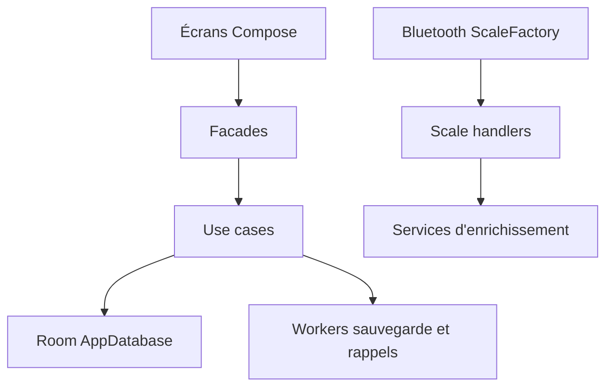

# oliexdev/openScale

> Application Android libre de suivi du poids et des mesures corporelles, avec balances Bluetooth.

## Le problème
Les applications de balances connectées exigent un compte et envoient les données dans le cloud.

## Ce que ça fait vraiment
Suit poids, IMC, graisse, eau, muscle, avec graphes, tableau et évaluation selon âge et taille. Récupère les mesures de nombreuses balances Bluetooth via des gestionnaires propres à chaque marque. Stockage local (Room), import et export CSV, multi-utilisateurs, widget d'écran d'accueil, sans permission internet.

## Comment c'est branché

## Essayer
Aucune commande documentée : installer l'application via Google Play (bêta) ou la version de développement des Releases GitHub.

## Coût et pièges
Gratuit, sans publicité. Le dossier `arduino_mcu` concerne une balance maison. La synchronisation externe passe par un projet séparé.

## Ce que ce n'est pas
Pas un service cloud : aucune synchronisation intégrée. Pas d'application iOS d'après le README.

## Alternatives
Aucune alternative nommée dans le README.

## Pour toi
À ignorer : application de santé personnelle sans lien avec la data ou le MLOps ; l'architecture en couches reste lisible si tu cherches un exemple.

