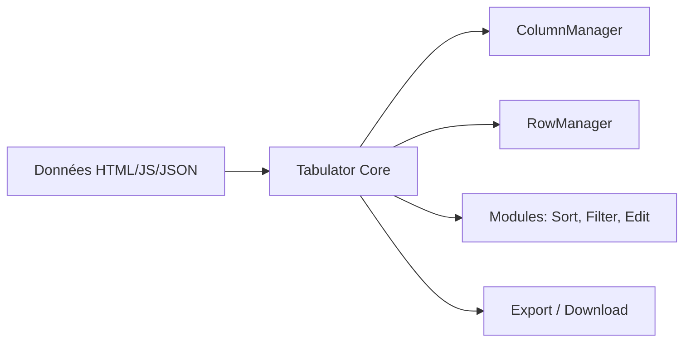

# olifolkerd/tabulator

> JavaScript library for interactive tables from HTML, JS arrays or JSON.

## The problem
Displaying, sorting and editing large tabular datasets in a web page takes a lot of code.

## What it actually does
Generates a table from an HTML element, a JS array or JSON. Modules for editing, formatting, sorting, filtering, frozen columns, resizing, trees, groups, import/export. Works with React, Angular and Vue.

## How it is wired


## Trying it
```bash
npm install tabulator-tables --save
npm run test:unit
npm run build
npx playwright test
```

## Cost and gotchas
Free (MIT). 400 open issues; the README does not detail governance.

## What it is not
Neither a spreadsheet nor a BI tool; it is a front-end component.

## Alternatives
No alternative named in the README.

## For you
Keep an eye on it: handy for a dashboard or a small JS data app, without being central.
