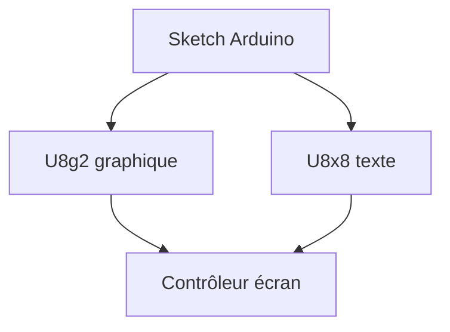

# olikraus/u8g2

> Graphics library for monochrome OLED and LCD displays on embedded systems.

## The problem
Driving dozens of monochrome display controllers requires different code for each one.

## What it actually does
Supports a large number of controllers (SSD1306, SH1106, ST7920…). U8g2 provides graphics primitives and many fonts with an in-memory buffer; U8x8 writes text directly, without a buffer. Installable via the Arduino library manager.

## How it is wired


## Trying it
```bash
# installation via le gestionnaire de bibliothèques de l'Arduino IDE
```

## Cost and gotchas
Free; U8g2 mode requires microcontroller RAM. License not identified by GitHub.

## What it is not
Not a library for color displays.

## Alternatives
No alternative named.

## For you
Ignore: embedded, outside data/AI/MLOps (except an Edge project with a display).
