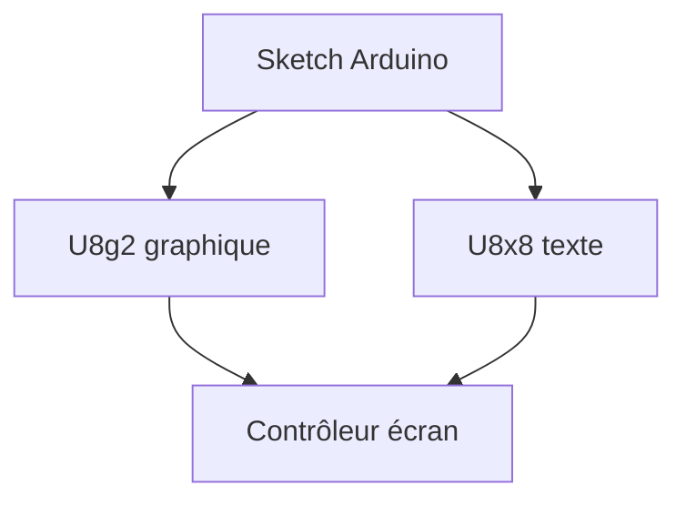

# olikraus/u8g2

> Bibliothèque graphique pour écrans monochromes OLED et LCD de systèmes embarqués.

## Le problème
Piloter des dizaines de contrôleurs d'écran monochromes demande un code différent pour chacun.

## Ce que ça fait vraiment
Gère un grand nombre de contrôleurs (SSD1306, SH1106, ST7920…). U8g2 offre les primitives graphiques et de nombreuses polices avec tampon en mémoire ; U8x8 écrit du texte directement, sans tampon. Installable via le gestionnaire de bibliothèques Arduino.

## Comment c'est branché


## Essayer
```bash
# installation via le gestionnaire de bibliothèques de l'Arduino IDE
```

## Coût et pièges
Gratuit ; le mode U8g2 demande de la RAM microcontrôleur. Licence non identifiée par GitHub.

## Ce que ce n'est pas
Pas une bibliothèque pour écrans couleur.

## Alternatives
Aucune alternative nommée.

## Pour toi
Ignorer : embarqué, hors data/IA/MLOps (sauf projet Edge avec écran).

