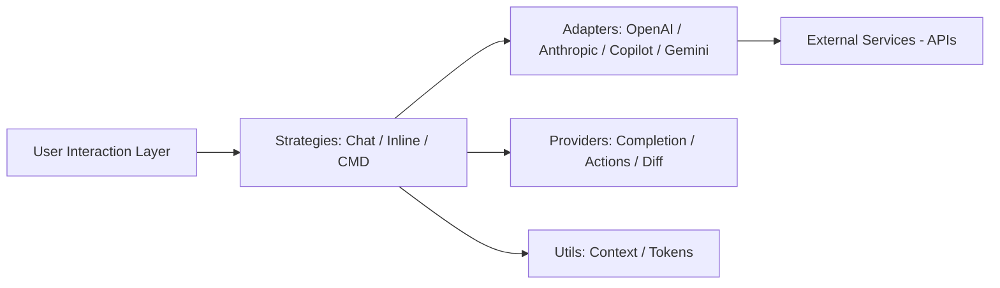

# olimorris/codecompanion.nvim

> Neovim plugin that connects the editor to LLMs and CLI agents, for developers.

## The problem
Use an AI assistant in Neovim without leaving the editor or switching tools.

## What it actually does
Chat in a buffer, inline transformations, command generation, tools/agents, MCP, the ACP protocol (Claude Code, Codex, Gemini CLI, etc.), skills and rules. Adapters for Anthropic, OpenAI, Gemini, Ollama, Copilot, Mistral and others. Code review of an agent's changes. Asynchronous execution.

## How it is wired


## Trying it
The README points to the documentation for installation and mentions the `@{search_help}` tool. No command appears in it.

```bash
# non documenté dans le README
```

## Cost and gotchas
API keys from the chosen providers, or local models (Ollama). A single apparent maintainer (personal owner).

## What it is not
Not an LLM: only the Neovim integration.

## Alternatives
No alternative named in the README.

## For you
Worth watching if you work in Neovim: wide choice of adapters and MCP; otherwise irrelevant.
