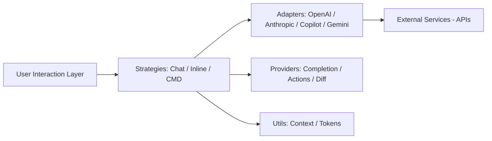

# olimorris/codecompanion.nvim

> Plugin Neovim qui relie l'éditeur à des LLM et agents en CLI, pour développeurs.

## Le problème
Utiliser un assistant IA dans Neovim sans quitter l'éditeur ni changer d'outil.

## Ce que ça fait vraiment
Chat dans un buffer, transformations en ligne, génération de commandes, outils/agents, MCP, protocole ACP (Claude Code, Codex, Gemini CLI, etc.), skills et règles. Adaptateurs pour Anthropic, OpenAI, Gemini, Ollama, Copilot, Mistral et autres. Revue de code des modifications d'un agent. Exécution asynchrone.

## Comment c'est branché


## Essayer
Le README renvoie à la documentation pour l'installation et mentionne l'outil `@{search_help}`. Aucune commande n'y figure.

```bash
# non documenté dans le README
```

## Coût et pièges
Clés d'API des fournisseurs choisis, ou modèles locaux (Ollama). Un seul mainteneur apparent (owner personnel).

## Ce que ce n'est pas
Pas un LLM : uniquement l'intégration à Neovim.

## Alternatives
Aucune alternative nommée dans le README.

## Pour toi
À surveiller si tu travailles sous Neovim : large choix d'adaptateurs et MCP ; sinon sans objet.

