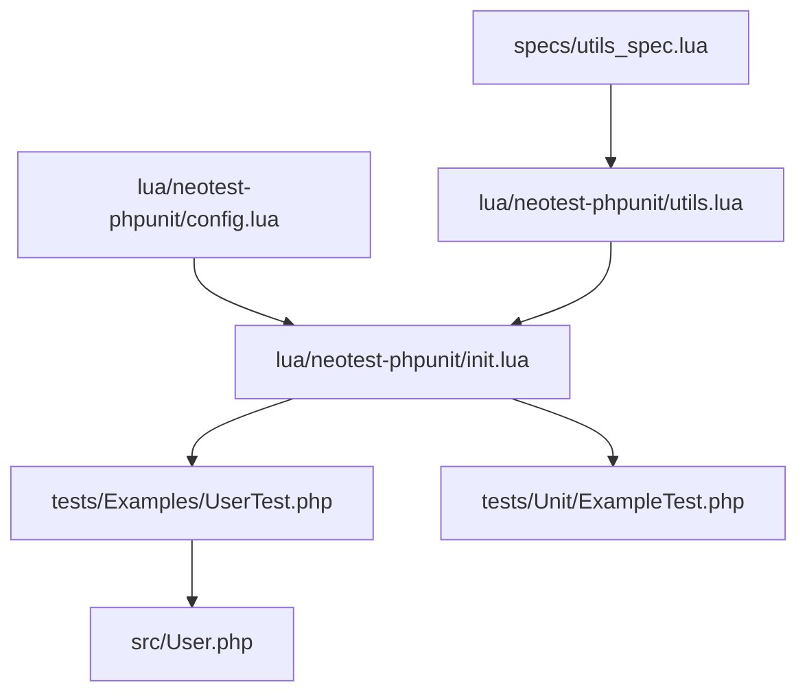

# olimorris/neotest-phpunit

> Neovim adapter to run PHPUnit tests from the Neotest framework.

## The problem
Running a PHPUnit test from the editor avoids switching to a terminal.

## What it actually does
`init.lua` discovers PHPUnit tests; `config.lua` sets the command (`vendor/bin/phpunit`), root files, filtered directories and environment. You can run a method, a file, a directory or the whole suite, and debugging goes through nvim-dap with Xdebug.

## How it is wired


## Trying it
```bash
# dans la configuration Neovim (lazy.nvim)
require("neotest").setup({ adapters = { require("neotest-phpunit") } })
```
```lua
require("neotest").run.run()
```

## Cost and gotchas
Neovim, Neotest and a PHP project with PHPUnit. Debugging requires nvim-dap, vscode-php-debug and Xdebug.

## What it is not
Not a standalone test runner: it only exists inside Neotest. Not compatible with Pest without configuration.

## Alternatives
No alternative named in the README (the Pest adapter is mentioned without a repository name).

## For you
Ignore: Neovim extension for PHP, unrelated to data or AI.
