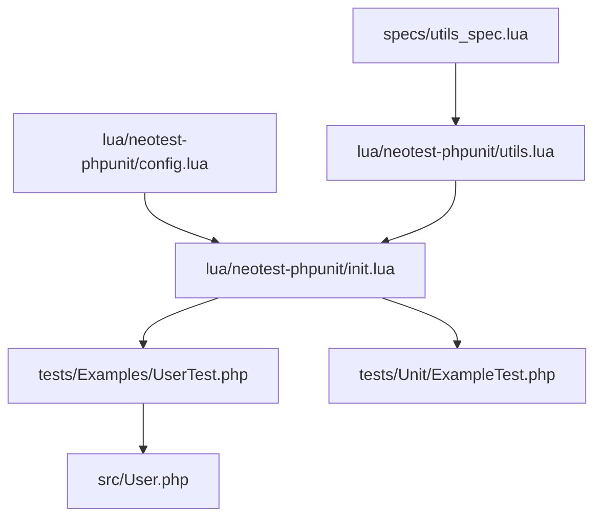

# olimorris/neotest-phpunit

> Adaptateur Neovim pour lancer des tests PHPUnit depuis le framework Neotest.

## Le problème
Lancer un test PHPUnit depuis l'éditeur évite de basculer vers un terminal.

## Ce que ça fait vraiment
`init.lua` découvre les tests PHPUnit ; `config.lua` règle la commande (`vendor/bin/phpunit`), les fichiers racines, les dossiers filtrés et l'environnement. On lance une méthode, un fichier, un dossier ou toute la suite, et le débogage passe par nvim-dap avec Xdebug.

## Comment c'est branché


## Essayer
```bash
# dans la configuration Neovim (lazy.nvim)
require("neotest").setup({ adapters = { require("neotest-phpunit") } })
```
```lua
require("neotest").run.run()
```

## Coût et pièges
Neovim, Neotest et un projet PHP avec PHPUnit. Le débogage demande nvim-dap, vscode-php-debug et Xdebug.

## Ce que ce n'est pas
Pas un exécuteur de tests autonome : il n'existe qu'à l'intérieur de Neotest. Pas compatible Pest sans réglage.

## Alternatives
Aucune alternative nommée dans le README (l'adaptateur Pest est évoqué sans nom de dépôt).

## Pour toi
À ignorer : extension Neovim pour PHP, sans lien avec la data ou l'IA.

