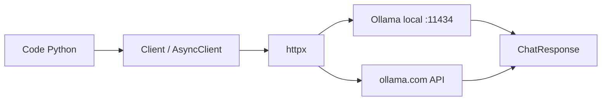

# ollama/ollama-python

> Official Python client for the Ollama REST API, synchronous, asynchronous and streaming.

## The problem
Calling a model served by Ollama over raw HTTP forces you to write your own stream parsing, error handling and response types.

## What it actually does
Exposes `chat`, `generate`, `list`, `show`, `create`, `copy`, `delete`, `pull`, `push`, `embed`, `ps`, modeled on the REST API. Responses are typed (`ChatResponse`, access by key or by attribute). `stream=True` returns a generator; `AsyncClient` returns an async generator. `Client` accepts a `host` and headers, and passes any extra kwarg to `httpx.Client`. Errors raise `ollama.ResponseError` with `status_code`.

## How it is wired


## Trying it
```bash
pip install ollama
ollama pull gemma4
ollama signin
export OLLAMA_API_KEY=your_api_key
```

## Cost and gotchas
Ollama must be installed and running, and the model downloaded beforehand. "Cloud" models (`gpt-oss:120b-cloud`, `kimi-k2:1t-cloud`, `qwen3-coder:480b-cloud`…) offload computation to Ollama: login, API key and associated billing.

## What it is not
Not an inference server: it is a client, Ollama is still required.
Not a multi-provider abstraction: the API is Ollama's, not a portable standard.
License not declared in the README.

## Alternatives
- **Ollama REST API** directly, if you want no Python dependency.

## For you
The shortest path between a Python script and a local model; keep it in the toolbox.
