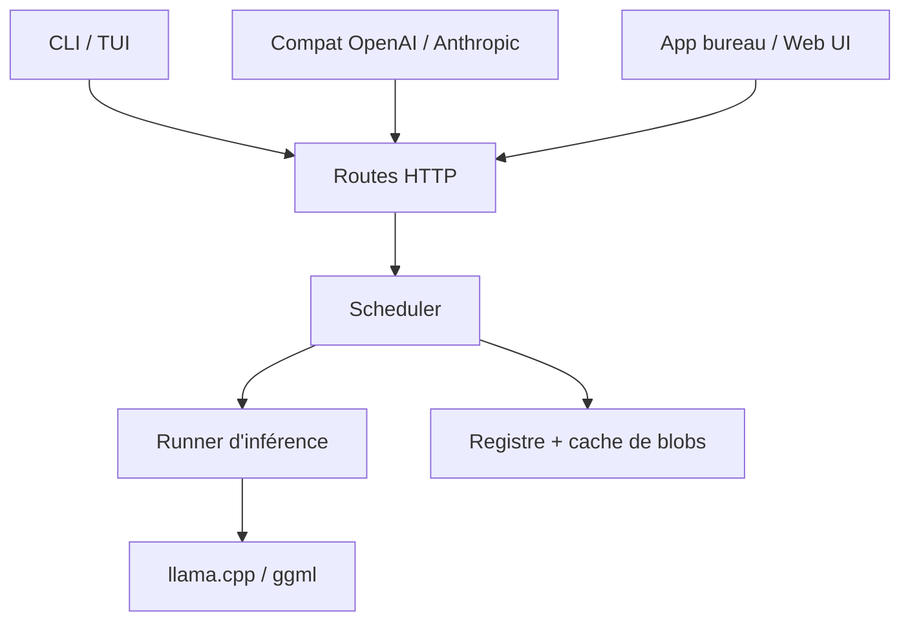

# ollama/ollama

> Local server for open models, with a command-line interface (CLI), a REST API, and compatibility with OpenAI/Anthropic.

## The problem
Running an open model locally requires managing weight, quantization, backend, and GPU memory.
Each application creates its own connection instead of communicating with a stable endpoint.

## What it actually does
Download, store, and serve models from a public library with a single command.
Provides a REST API on `localhost:11434`, along with OpenAI and Anthropic compatibility layers.
Launches integrations for code agents (e.g., `ollama launch claude`, Codex, Copilot, OpenCode…).
Official Python and JavaScript SDK; official Docker image; desktop and TUI interface.

## How it is wired


## Trying it
```shell
curl -fsSL https://ollama.com/install.sh | sh
ollama run gemma4
curl http://localhost:11434/api/chat -d '{"model":"gemma4","messages":[{"role":"user","content":"Why is the sky blue?"}],"stream":false}'
```

## Cost and gotchas
Free to use, no payment required. The actual cost is hardware-related: RAM and VRAM, depending on the size of the chosen model.

The installation script is a `curl | sh` command – please read it before running it on a working machine.

## What it is not
Not a high-throughput, multi-user inference server: it's a desktop runtime.
Not a model provider: the quality depends entirely on the downloaded model.
The extensive list of integrations in the README refers to third-party ecosystems, not the code maintained here.

## Alternatives
- `vllm-project/vllm`: designed for multi-user use, with high throughput and parallelism.
- `NousResearch/hermes-agent`: If the need is for an assistant, not a model server.

## For you
The obvious local setup for prototyping without an API key. Should be kept installed at all times.
