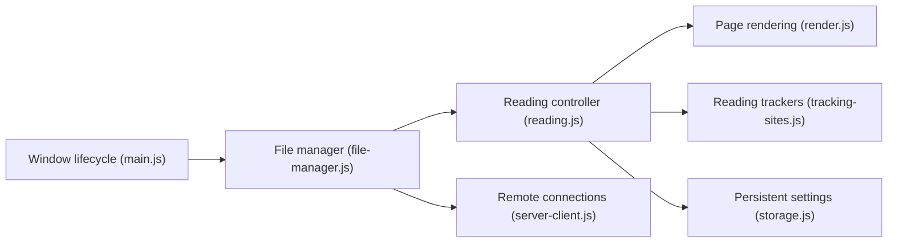

# ollm/OpenComic

> Cross-platform Electron comic and manga reader, reading archives, PDFs and remote servers.

## The problem
Reading comic collections in various formats (CBZ, CBR, PDF, EPUB) with progress tracking and image settings.

## What it actually does
- Reads images (JPG, AVIF, WEBP...), archives (RAR, ZIP, 7Z, CBZ...), PDF and EPUB (alpha).
- Access to smb, ftp, sftp, s3, webdav servers; OPDS catalogs.
- Manga, webtoon, double page modes, magnifier, color filters.
- Tracking with AniList, MyAnimeList, Mangabaka, Bangumi.

## How it is wired


## Trying it
```bash
git clone https://github.com/ollm/OpenComic.git
cd OpenComic
npm install
npm start
```

## Cost and gotchas
Free. Node and npm for development; otherwise installers (exe, dmg, deb, flatpak, snap, AppImage). If the build fails: `npm install --force` in `build/node-zstd-native-dependencies`.

## What it is not
Not a comic downloader. No online library provided.

## Alternatives
No alternative named in the README.

## For you
Ignore: hobby application unrelated to your work, even though it is mature (created in 2017).
