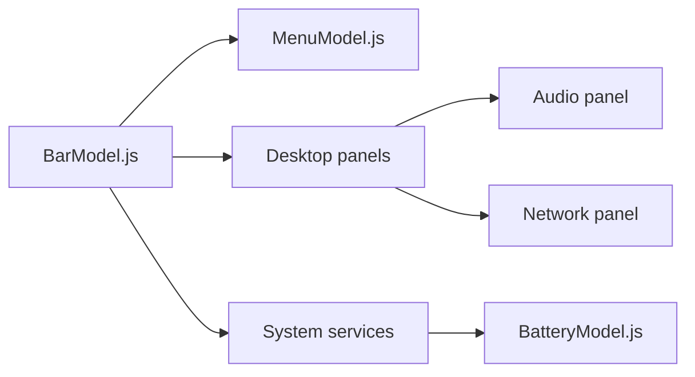

# omacom/omarchy

> Linux distribution focused on desktop tiling, presented by DHH, with its accompanying manual.

## The problem
Setting up a consistent Linux desktop environment (including the taskbar, themes, keyboard shortcuts, and tools) requires a significant amount of time and effort for configuration.

## What it actually does
The README is a table of contents for the manual (the `manual/` directory): basics, applications, configuration, troubleshooting. The described architecture shows a shell with a top bar, menus, clipboard history, notifications, panels (audio, network, weather, Bluetooth), and system services. The README does not document the installation process.

## How it is wired
QML links are not validated; only a list of components is provided.

## Trying it
No documented command: see omarchy.org and the manual.

## Cost and gotchas
Free. Over 5,700 open issues. Installation, hardware requirements, and system content are not specified here.

## What it is not
This is not a data science tool or a distribution intended for GPU computing; none of these features are specified.

## Alternatives
No alternative is specified in the README file.

## For you
Things to be aware of: personal workspace environment, a README that is too brief to assess, and no connection to data or AI.
