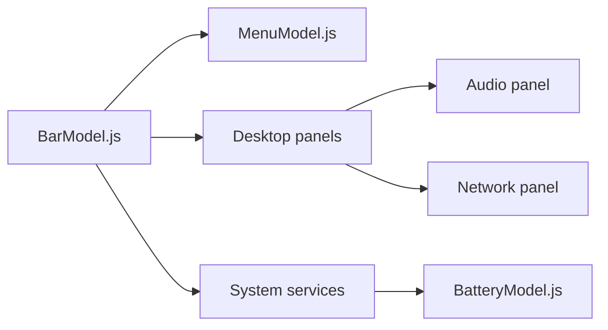

# omacom/omarchy

> Distribution Linux orientée bureau tiling, présentée par DHH, avec son manuel.

## Le problème
Monter un bureau Linux cohérent (barre, thèmes, raccourcis, outils) demande de longues heures de configuration.

## Ce que ça fait vraiment
Le README est une table des matières du manuel (dossier `manual/`) : bases, applications, configuration, dépannage. L'architecture décrite montre un shell avec barre supérieure, menus, historique du presse-papiers, notifications, panneaux (audio, réseau, météo, Bluetooth) et services système. Le README ne documente pas l'installation.

## Comment c'est branché
Les liens QML ne sont pas vérifiés ; liste des composants seulement.

## Essayer
Aucune commande documentée : voir omarchy.org et le manuel.

## Coût et pièges
Gratuit. Plus de 5 700 issues ouvertes. Installation, prérequis matériels et contenu du système non précisés ici.

## Ce que ce n'est pas
Pas un outil de data science ni une distribution destinée au calcul GPU, rien de tel n'est indiqué.

## Alternatives
Aucune alternative nommée dans le README.

## Pour toi
À ignorer : environnement de bureau personnel, README trop mince pour juger, et aucun lien avec la data/IA.

