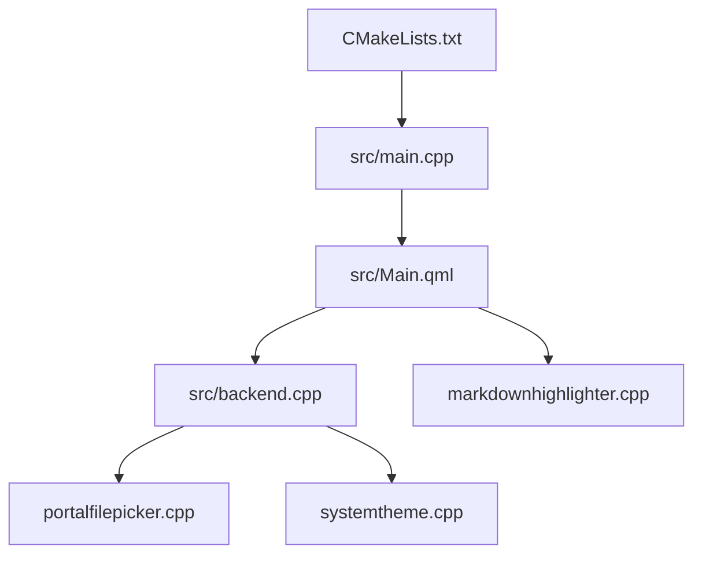

# omacom/omawrite

> Minimalist Markdown editor in Qt Quick and C++ that follows the system's light or dark mode.

## The problem
Writing Markdown without a heavy editor, on a Linux desktop that must follow the system theme.

## What it actually does
Qt Quick editor with autosave of saved files, draft recovery after a crash, a warning if a file changes on disk, search and replace, Markdown shortcuts and copying the rendering as HTML. IBM Plex Mono font embedded.

## How it is wired


## Trying it
```sh
./bin/build
./bin/test
./build/omawrite path/to/document.md
```

## Cost and gotchas
Free. Requires Qt 6 and xdg-desktop-portal; package installation targets Arch Linux and Omarchy (makepkg).

## What it is not
Not a note-taking or publishing tool: a simple Markdown text editor. No documented Windows or macOS version.

## Alternatives
No alternative named in the README.

## For you
Ignore: yet another Markdown editor for Omarchy, with no connection to data, AI or MLOps work.
