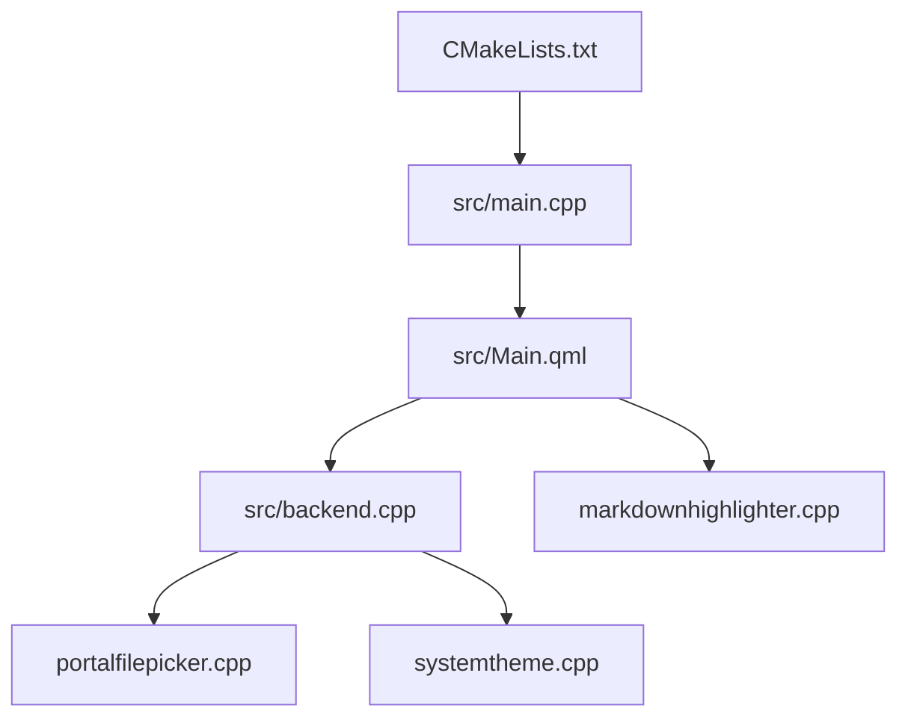

# omacom/omawrite

> Éditeur Markdown minimaliste en Qt Quick et C++ qui suit le mode clair ou sombre du système.

## Le problème
Écrire du Markdown sans éditeur lourd, sur un bureau Linux qui doit suivre le thème du système.

## Ce que ça fait vraiment
Éditeur Qt Quick avec sauvegarde automatique des fichiers enregistrés, récupération des brouillons après un arrêt brutal, avertissement si un fichier change sur le disque, recherche et remplacement, raccourcis Markdown et copie du rendu en HTML. Police IBM Plex Mono embarquée.

## Comment c'est branché


## Essayer
```sh
./bin/build
./bin/test
./build/omawrite path/to/document.md
```

## Coût et pièges
Gratuit. Requiert Qt 6 et xdg-desktop-portal ; l'installation par paquet vise Arch Linux et Omarchy (makepkg).

## Ce que ce n'est pas
Pas un outil de notes ou de publication : un simple éditeur de texte Markdown. Pas de version Windows ou macOS documentée.

## Alternatives
Aucune alternative nommée dans le README.

## Pour toi
À ignorer : un éditeur Markdown de plus pour Omarchy, sans lien avec un travail data, IA ou MLOps.

